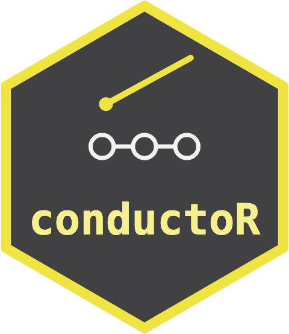

# conductoR 

<!-- badges: start -->
[](https://lifecycle.r-lib.org/articles/stages.html#experimental)
[](https://github.com/max578/conductoR/actions/workflows/R-CMD-check.yaml)
[](https://app.codecov.io/gh/max578/conductoR)
[](https://max578.r-universe.dev/conductoR)
<!-- badges: end -->

Perform an analytical plan as a directed acyclic graph of nodes, each bound to a tool that returns an `orchestraManifest::orchestra_manifest`. Every edge is typed by the inferential target the upstream node declares, and a mismatched handoff stops the run before the downstream node executes.

Two operators are built in. An abstention gate refuses to pass a `no_effect` verdict from a design too small or too weak to have resolved the implied effect, and can flag, halt the branch or reroute. A triangulation reconciles any number of independent lenses on one question into one of seven consensus headlines.

A plan writes to YAML and reads back to the same run, compiles to a `targets` pipeline, and every run leaves a provenance record with the chain of payload hashes. Writing a plan from a question and a tool roster automatically is a future prospect.

## Related packages

- [targets](https://CRAN.R-project.org/package=targets) runs Make-like
  pipelines, skipping steps whose code and data have not changed and
  running the rest in parallel.
- [maestro](https://CRAN.R-project.org/package=maestro) organises,
  schedules and monitors several data pipelines in one project.
- [mlr3pipelines](https://CRAN.R-project.org/package=mlr3pipelines)
  composes preprocessing, model fitting and ensemble steps into graphs
  that can be resampled, benchmarked and tuned as one learner.

These manage how steps run. conductoR checks what passes between them:
each edge carries a declared inferential target, and an abstention gate
and a triangulation act on the results. A conductoR plan can be compiled
to a targets pipeline to use its caching and parallel runs.

## Getting started

```r
lens <- node("lens", tool = "ols_lens", emits = "treatment_effects")
gate <- node("gate", operator = "abstain_gate", emits = "decisions",
             consumes = list(edge("lens", "treatment_effects")), params = list(n_min = 25L))
run  <- conduct(oap_plan(id = "one", nodes = list(lens, gate)), data = my_data)
run$terminal@summary$headline
```

## What returns to the composer

When a plan is written against a masked copy of the data and run by the
holder of the real data, only a typed message goes back to the person who
wrote it. `run_record()` builds the dose-0 record: one row per node with what
it emitted and how it ended, and one row per declared trigger with whether it
fired, with no data value in either. `run_return()` turns the record into
message lines such as `stop` or `quorum assumption_check_failed`, and at dose
1 or above adds the summary values the plan asked for, each passed through a
check that refuses a value resting on too few units. `write_return()` files
each return under `<series>/round_<k>/`, and `series_report()` lists the
rounds and counts the returns above dose 0 against the holder's budget. The
check is a floor, not a disclosure guarantee.

```r
run <- try_conduct(plan, data = real_table)
ret <- run_return(run, triggers = triggers, dose = 1,
                  requests = list(pooled = c(rise = 1)),
                  series = "W2", round = 2)
write_return(ret, "W2")
series_report("W2", budget = 3)
```

Install from GitHub with `remotes::install_github("max578/conductoR")`, which also installs `orchestraManifest`. See `vignette("conductoR")` for a worked example on `agridat::hernandez.nitrogen`. MIT licence.
